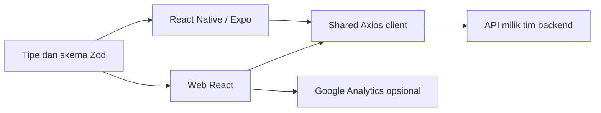

# Arsitektur frontend

`web/` menangani desktop dan mobile web dengan React Router dan CSS responsif. Token sesi berada di sessionStorage; keranjang dan favorit berada di localStorage. Halaman selain Home dimuat saat dibutuhkan.

`mobile/` memakai React Navigation, SecureStore untuk token, dan AsyncStorage untuk keranjang, favorit, serta receipt terakhir. Foto katalog dan font dibundel. Preview browser merender komponen app yang sama, tetapi pengujian ponsel tetap diperlukan.

`packages/api-client/` menyediakan Axios client, header Bearer token, dan penanganan error bersama. `packages/contracts/` berisi skema Zod, tipe domain, katalog demo, format rupiah, serta aturan keranjang, pengiriman, dan receipt. Komponen UI tetap terpisah sesuai platform.

Tanpa URL API, web dan app menjalankan mode demo. Jika URL diisi, keduanya memakai endpoint dalam `docs/API.md`. Autentikasi, penyimpanan database, izin pengguna, perhitungan harga akhir, idempotensi checkout, dan deployment server ditangani tim backend. Validasi frontend membantu pengguna mengisi form; server tetap harus memvalidasi setiap request.

Semua workspace memakai TypeScript strict. Konfigurasi bersama berada di `tsconfig.base.json`; tipe domain ada di `packages/contracts/src/types.ts`. Data dari jaringan dan penyimpanan tetap memerlukan pemeriksaan runtime. Source server, konfigurasi database, dan deployment backend tidak disertakan.
