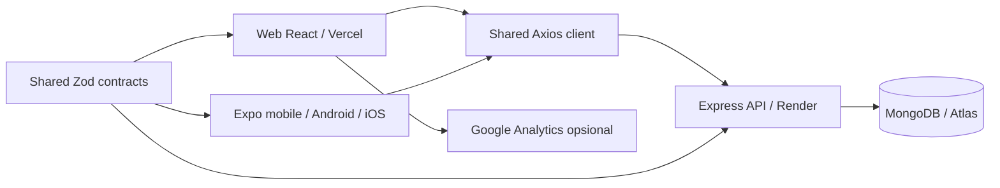

# Arsitektur Labuibu

`web` memiliki React Router, HTML/CSS responsif, sesi token di sessionStorage, keranjang/favorit di localStorage, dan dashboard admin. SessionStorage dipilih untuk membatasi durasi token di browser; token masih dapat diakses JavaScript, sehingga pencegahan XSS tetap penting. Web dapat berjalan dalam mode demo bila URL API tidak diisi.

`mobile` menggunakan native-stack dan bottom tabs dari React Navigation, SecureStore untuk token JWT, serta AsyncStorage untuk keranjang, favorit, dan receipt terakhir. App menyediakan mode demo saat URL API kosong. Foto katalog dan font dibundel untuk pemakaian offline; URL web dipakai untuk gambar baru dari API.

`packages/api-client` memiliki adapter token asinkron yang kompatibel dengan sessionStorage dan SecureStore. `packages/contracts` menyediakan skema validasi Zod, data seed, fungsi format rupiah, harga ongkir, serta aturan keranjang dan receipt yang dipakai web/app. Web, mobile, dan backend berbagi kontrak, tetapi setiap platform tetap memiliki komponen UI sendiri.

`backend` menyimpan pengguna, produk, dan pesanan dalam MongoDB melalui Mongoose. Password di-hash bcrypt. JWT memiliki algoritma, issuer, audience, subject, expiry 1 hari, dan versi token. Middleware mengambil pengguna dari database setiap request, sehingga perubahan role, penghapusan akun, dan logout segera berlaku. Role admin dibuat lewat seed, bukan registrasi publik.

Model User berisi nama, email unik, passwordHash, role, tokenVersion, dan timestamps. PasswordHash tidak diserialisasi. Product memakai slug `id` unik, nama, kategori, harga dalam rupiah integer, ukuran, badge, gambar, deskripsi, bahan/alergen, penyimpanan, dan status aktif. Order menyimpan owner userId, snapshot item dan harga saat order, data penerima, ongkir, total, metode pengiriman/pembayaran, status, requestHash, dan idempotencyKey. Unique index `(userId, idempotencyKey)` mencegah order ganda dalam retry paralel. Index dibuat sebelum menerima transaksi pada database baru; seed menginisialisasi index, dan Mongoose juga menginisialisasi model saat server berjalan.

API menghitung harga dari produk aktif, menolak item ganda/quantity tidak valid, dan menyimpan snapshot harga historis. Total yang ditampilkan sebelum submit bersifat estimasi; receipt memakai total yang dikembalikan server. Transisi status: processing ke shipped/cancelled, shipped ke completed. Update status memiliki pemeriksaan konkurensi.

Penghapusan produk menonaktifkan katalog. Penghapusan akun customer melalui API menghapus order customer sebelum menghapus pengguna. Akun admin dilindungi dari endpoint delete.

Rate limiter disimpan dalam memori proses; untuk beberapa instance API, gunakan shared store. Tidak tersedia refresh token, pemulihan kata sandi, verifikasi email, payment gateway, stock reservation, ongkir kurir nyata, atau upload gambar. Produk menggunakan path gambar bawaan atau URL HTTPS.
